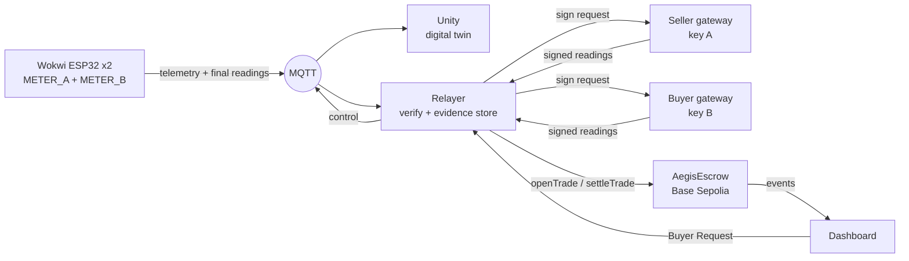

<div align="center">


# Aegis-Grid Africa

**Neighbour-to-neighbour solar power during load shedding, paid on-chain only when two meters agree.**


Tech Hub Africa Hackathon 2026

</div>

| | |
|---|---|
| 🎬 Demo video | _add before submission_ |
| 🌐 Live dashboard | _add before submission_ |
| 🔌 Wokwi simulation | _add before submission_ |
| 📜 Contract v2 (Base Sepolia) | [`0x2736…fc6e`](https://base-sepolia.blockscout.com/address/0x273651238fe3e2279d2295edcbd005f31347fc6e) |
| 🧾 On-chain evidence | [docs/evidence.md](docs/evidence.md) |

> [!NOTE]
> A working prototype on a public testnet. The two meters are simulated ESP32s in Wokwi, and the buyer meter is derived from the seller meter. The escrow and its signature checks are real contracts on Base Sepolia; settlements of simulated trades run only in labelled testnet demos (`SIMULATED_TESTNET_SETTLEMENT`). See [What is real](#what-is-real-and-what-is-simulated).

## The problem

- ☀️ **Wasted solar at noon.** Home solar often produces more than local batteries can absorb, and the surplus is curtailed.
- 🌙 **Load shedding at night.** Outages hit when shops need light and refrigeration most.
- 🛢️ **Diesel as the fallback.** Small businesses run generators that are costly and pollute the street.

## The solution

Households that already own a battery sell its stored solar energy to the shop next door during an outage. Each side has a smart meter that signs what it measured, and a smart contract releases the payment only when both readings agree.



1. **Day:** the battery charges from solar surplus.
2. **Outage:** the microgrid is islanded from the utility grid (the PCC opens). The shop presses **Request clean power** and pays a deposit into escrow.
3. **Supply:** the battery serves the shop first and keeps a 5% reserve. Community loads get power only if the owner allows emergency backup.
4. **Verification:** both meters report their final energy. The backend checks them (same trade, buyer ≤ seller, gap within 3%, on the exact and on the whole-Wh values) and stores the evidence.
5. **Settlement:** each meter's gateway signs its own reading, and the contract checks both signatures and pays for what the shop received. Readings that disagree are never paid. For simulated meters this step is off by default and runs only in labelled testnet demos.

> [!IMPORTANT]
> Feeding power into utility lines during an outage endangers line workers. The design assumes a community microgrid with an islanding switch, so P2P supply happens only inside the islanded street.

## Proof on Base Sepolia

| What | Result |
|---|---|
| **Live Wokwi trade, two ESP32 meters (Stage 5B, contract v2)** | METER_A 9.444 Wh, METER_B 9.256 Wh (2.0%) → whole Wh 9 / 9 → both gateways signed → **settled**, labelled `SIMULATED_TESTNET_SETTLEMENT` · [tx](https://base-sepolia.blockscout.com/tx/0xa354a8bfe7cec59ffd5460a00617f5c2ce25cba7ed5a1770de82af3a2d9a6404) |
| Honest trade (Wokwi Stage 4E model, contract v2) | 238 Wh sent, 233 Wh received (2.1%) → **settled** · [tx](https://base-sepolia.blockscout.com/tx/0xcf67f87b80471e80f406eb1b8d00d6773da470d4e20a2094ecee160d9efb8138) |
| Tampered buyer meter (contract v1) | 138 vs 81 Wh → **disputed, funds frozen** · [details](docs/evidence.md) |
| Seller payout | `withdraw()` paid out; a second attempt reverted · [details](docs/evidence.md) |
| Cost per settlement | ~98k to 184k gas measured on-chain; a dispute costs ~58k |
| Tests | 26 contract tests · 36 backend tests |

## What is real and what is simulated

| Part | Status |
|---|---|
| Seller meter (METER_A) | 🟡 Simulated: ESP32 in Wokwi, potentiometers instead of sensors |
| Buyer meter (METER_B) | 🟡 Simulated: second ESP32 in Wokwi, derived from METER_A with 2% line loss (not an independent measurement) |
| Meter signatures | 🟡 Each meter's key is held by a separate gateway process that attests its own Wokwi final reading; the contract checks both registered signers |
| On-chain settlement of Wokwi trades | 🟡 Off by default (`SETTLEMENT_MODE=off`: verified only). Testnet demo runs are labelled `SIMULATED_TESTNET_SETTLEMENT` |
| Digital twin | 🟢 Unity scene, driven live by the Wokwi telemetry |
| Signed readings, verification | 🟢 Real: EIP-712 signatures, checked again by the contract |
| Escrow, fee split, disputes, payouts | 🟢 Real contract on Base Sepolia (test ETH, no real money) |
| Mobile money, phone login | 🔴 Simulated in the UI only; roadmap |
| Offline LoRa mesh | 🔴 Design only; roadmap |

## Prices and the demo scale

The meters in Wokwi measure a small model of a street. A trade there is **10–100 Wh**, but a real shop needs **1–10 kWh** to get through one load-shedding block. Prices on such small amounts would be fractions of a cent, so the simulated mobile-money layer uses a **demo scale of ×100**:

> **1 Wh measured in the demo = 100 Wh at a real shop.** A 20 Wh order stands for 2 kWh, about 4 hours of a 500 W shop.

| Price | Per kWh | Source / reasoning (October 2026, about GH₵12.25 per US$) |
|---|---|---|
| Utility grid, non-residential | ~$0.15 | PURC tariff GH₵1.84/kWh (0–300 kWh), from 1 July 2026 |
| **Aegis P2P price** | **$0.30** | Demo assumption: the battery owner earns about **2×** the grid price |
| Small diesel generator (fuel only) | ~$0.47 | Diesel ~GH₵19.30/L ($1.58) × 0.3 L/kWh: the shop pays about **⅓ less** with Aegis |

| Demo order | Real-world energy | Shop pays | Seller receives (83%) | Same energy from a generator |
|---|---|---|---|---|
| 10 Wh | 1 kWh | $0.30 | $0.25 | $0.47 |
| 20 Wh | 2 kWh | $0.60 | $0.50 | $0.94 |
| 50 Wh | 5 kWh | $1.50 | $1.25 | $2.35 |
| 100 Wh | 10 kWh | $3.00 | $2.49 | $4.70 |

How it runs:

1. The shop picks an order in measured Wh. The dashboard shows what it stands for ("= 2 kWh at a real shop") and the deposit in US$ (`web/src/lib/momo.js`: `realKWh`, `whToFiat`).
2. The escrow on Base Sepolia is opened for the **measured** Wh (order + cable loss + stop margin) at 1 gwei per Wh. The scale never touches the chain.
3. Both meters report measured Wh; the backend and the contract check them (3% tolerance, whole Wh) exactly as before.
4. After settlement, the receipt shows the measured Wh, the real-world kWh they stand for, and the US$ amounts: the shop pays for what its meter received, the seller gets 83%, the utility 15%, Aegis 2%, and the unused deposit goes back to the shop's MoMo. "Saved vs a diesel generator" and the Impact page use the same real-world energy.

Settings in `web/.env.local`: `VITE_DEMO_ENERGY_SCALE` (default 100), `VITE_P2P_USD_PER_KWH` (0.30) and `VITE_DIESEL_USD_PER_L` (1.58). All three are demo assumptions, and mobile money is simulated: no payment API is called and no real money moves.

## Quick start

Requires Node.js 20+, [Foundry](https://getfoundry.sh) and Git. On Windows use WSL 2 ([setup guide](docs/dev-setup.md)).

```bash
git clone --recurse-submodules https://github.com/la-prmtsr/aegis-grid-africa.git
cd aegis-grid-africa && cp .env.example .env   # testnet keys only, never commit .env

cd contracts && forge test && cd ..           # 26 tests
cd bridge && npm install && npm test          # 36 tests
```

Run the demo without hardware (needs testnet keys and contract v2 in `.env`, see the [integration guide](docs/integration-v2.md)):

```bash
# terminal 1: Wokwi-compatible mock + Meter A + Meter B + relayer
cd bridge && npm run v2:mock        # verify only; SETTLEMENT_MODE=testnet npm run v2:mock settles on testnet

# terminal 2: sign in on http://localhost:5173/auth.html (user account, or the Operator tab for the control room)
cd web && npm install && npm run dev
```

In the dashboard (signed in as the operator): **Operator → Control room** (PV, load, utility outage, emergency backup, engine Mock or Wokwi live), turn on **Utility outage**, then **Buyer → Get power**, choose an order (10–100 Wh) and pay with MoMo. The supply stops by itself when the order is reached (or press **Stop and pay**). Turn on **Tamper Meter B** first: the shop's meter then under-reports by 40%, and the contract freezes the deposit as *Disputed* (testnet mode; check the firmware first with `npm run v2:tamper-check`). Receipts are in **Operator → Oracle**. Unity only visualises; every control is in the dashboard. Deployment, the Mosquitto bridge for Wokwi and all MQTT topics: [docs/integration-v2.md](docs/integration-v2.md).

## Repository

```
contracts/      AegisEscrow.sol + Foundry tests and deploy script
bridge/         backend: Meter A gateway, Meter B, relayer (src/v2), Wokwi adapter (src/aegis-unity)
web/            landing page, sign-in and live dashboard
docs/           integration guide, evidence, Mosquitto bridge config, setup
firmware/, tools/sim/   v1 meters, kept for the v1 evidence
```

| Layer | Stack |
|---|---|
| Contract | Solidity 0.8.28 · OpenZeppelin 5.4 · Foundry |
| Backend | Node.js 22 · ethers 6 · MQTT.js |
| Simulation | ESP32 on Wokwi · Unity · Mosquitto bridged to HiveMQ |
| Dashboard | Vite · JavaScript · three.js |

<details>
<summary><b>Smart contract functions</b></summary>

| Function | Caller | Purpose |
|---|---|---|
| `registerMeter(meter)` | household | Register the key that signs its meter readings |
| `openTrade(seller, pricePerWh, maxWh, duration)` | buyer | Escrow `maxWh × pricePerWh` |
| `settleTrade(id, sellerReading, sig, buyerReading, sig)` | relayer (anyone) | Check both signatures; settle or mark *Disputed* |
| `withdraw()` | anyone with a balance | Pull payment |
| `resolveDispute(id, acceptedWh)` | owner (arbiter) | Settle a disputed trade |
| `refundExpired(id)` | anyone | Refund an expired trade, or a dispute after 7 days |

Signatures are bound to the chain, the contract and the trade, so they cannot be replayed. Pausing never traps funds. **Tested, not audited.** The single-owner arbiter is a prototype simplification.

</details>

<details>
<summary><b>Design parameters</b> (choices, not measurements)</summary>

| Parameter | Value |
|---|---|
| Battery reserve | 5% (contract v2 and Wokwi; v1 used 20%) |
| Allocation during an outage | Buyer first; community load only with emergency-backup permission |
| Reading tolerance / simulated line loss | 3% / 2% |
| Fee split | 15% utility (grid fee) · 2% platform · rest to the seller |
| Demo price | 1 gwei per Wh (tiny, so the demo runs on faucet test ETH) |
| Energy accounting speed | 60× (1 s = 1 simulated minute), checked against the Wokwi battery model at run time |
| Trade energy counter | Real time in Faras's firmware (`FIRMWARE_ENERGY_SCALE=1`): 500 W gives 20 Wh in about 2.4 min; orders 10–100 Wh |
| Money | Demo energy scale ×100 at $0.30/kWh, see "Prices and the demo scale" |

</details>

<details>
<summary><b>Impact method</b></summary>

```
diesel avoided (L) = delivered energy (kWh) × generator fuel use (L/kWh)
CO2 avoided (kg)   = diesel avoided (L) × emission factor (kg CO2/L)
```

The dashboard uses 0.3 L/kWh and 2.68 kg CO2/L as **assumptions** until sources are cited. All energy figures in the demo come from simulated meters.

</details>

## Roadmap

- Certified meters with a hardware secure element instead of software keys
- Stablecoin settlement with mobile money payout and phone-number login
- Staking or a decentralised oracle instead of a single arbiter
- A pilot on one street, with the utility as a demand-response partner


## License

[MIT](LICENSE)
