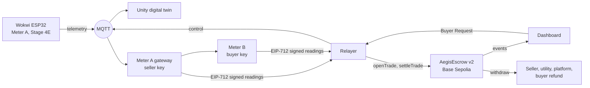

# Aegis-Grid Africa

> Powering Africa's Future: Zero Energy Waste, Zero Diesel Smoke.

Neighbourhood home batteries store midday solar energy that would otherwise be wasted, then sell it peer to peer to nearby shops during load shedding, instead of diesel generators. Both smart meters sign what they measured, and an escrow smart contract pays only when the two readings agree.

Built for the Tech Hub Africa Hackathon 2026. Track: **Electricity Efficiency**.

- **Contract v2** (5% battery reserve, used with the Wokwi + Unity demo): [`0x273651238fe3e2279d2295edcbd005f31347fc6e`](https://base-sepolia.blockscout.com/address/0x273651238fe3e2279d2295edcbd005f31347fc6e)
- **Contract v1** (Base Sepolia, source verified): [`0x918ad58816c6d09137eB4075c2BA5c3e56aC4f6a`](https://base-sepolia.blockscout.com/address/0x918ad58816c6d09137eB4075c2BA5c3e56aC4f6a)
- **On-chain evidence** (honest trade, tampered trade, payout): [docs/evidence.md](docs/evidence.md)
- **How the parts connect:** [docs/integration-v2.md](docs/integration-v2.md)
- Demo video: _TODO before submission_
- Live dashboard: _TODO before submission_
- Wokwi simulation: _TODO before submission_

## The problem

- **Wasted solar at midday.** Home and community solar systems often produce more than local batteries can absorb around noon, and the surplus is curtailed.
- **Load shedding at night.** Planned outages hit when demand peaks in the evening, which is when shops and homes need light and refrigeration most.
- **Diesel as the fallback.** During outages, small businesses run petrol or diesel generators, which are expensive to run and pollute the air and the street with fumes and noise.

## The solution

Aegis-Grid turns the batteries that households already own into a shared, neighbourhood-scale buffer:

1. **Onboarding.** Each household registers the signing key of its smart meter on the contract.
2. **Surplus charge (day).** Batteries charge from solar surplus that the grid connection point would otherwise curtail.
3. **Emergency P2P discharge (night).** During load shedding the point of common coupling (PCC) opens and the street's microgrid is islanded from the utility grid. A shop (UMKM) presses *Request Clean Power*; a nearby battery owner's inverter supplies it first (buyer first), keeping a 5% battery reserve. Community loads such as the city hall are supplied only if the battery owner allows emergency backup.
4. **Dual-meter verification and settlement.** The seller's meter signs the energy it sent, the buyer's meter signs the energy it received. The escrow contract pays for what the buyer received if the two agree within 3%; otherwise it freezes the funds as *Disputed*.

Electrical safety note: exporting into utility lines during an outage is dangerous for line workers. The design therefore assumes a community microgrid with an islanding switch at its connection point, so P2P supply happens only inside the islanded microgrid.

## What is real vs simulated

| Component | Status in this prototype |
|---|---|
| Seller meter (Meter A) | **Simulated**: ESP32 in Wokwi (Stage 4E firmware; potentiometers stand in for sensors) plus a gateway that counts the energy per trade |
| Digital twin | Unity scene driven live by the same Wokwi telemetry |
| Buyer meter (Meter B) | **Simulated**: a separate meter process with its own key; its input is the Wokwi power flow with 2% line loss |
| Meter signing keys | Software keys, one per meter process; the relayer holds none. A hardware secure element is the production design |
| Dual-meter verification | **Real**: EIP-712 signatures checked on-chain by the contract |
| Escrow, fee split, disputes, payouts | **Real** smart contract on the Base Sepolia testnet (test ETH, no real money) |
| Phone-number login, mobile money payout | Not implemented; roadmap |
| Offline LoRa / ESP-NOW mesh | Design only; roadmap |

## Architecture



Topics, message fields, verification rules and how to run each part: [docs/integration-v2.md](docs/integration-v2.md).

## Tech stack

| Layer | Used |
|---|---|
| Smart contract | Solidity 0.8.28, OpenZeppelin Contracts 5.4.0, Foundry (forge, cast) |
| Network | Base Sepolia testnet (chain id 84532) |
| Backend | Node.js 22, ethers 6, mqtt 5, dotenv (meter gateway, meter B, relayer) |
| Meter A | ESP32 on Wokwi (Stage 4E firmware) |
| Digital twin | Unity |
| Dashboard | Vite, plain JavaScript, three.js, ethers |
| Messaging | MQTT: Mosquitto on the simulation laptop, bridged to the public HiveMQ broker |

## Repository structure

```
contracts/                AegisEscrow.sol (v2: 5% reserve), 26 Foundry tests, deploy script
bridge/src/v2/            backend v2: Meter A gateway, Meter B, relayer, Wokwi Stage 4E mock, setup
bridge/src/aegis-unity/   Stage 5A adapter (Faras): Wokwi telemetry checks and buyer-first allocation
bridge/test/              19 tests (adapter + v2 meters, verification, signatures)
web/                      landing page, sign-in and live console
docs/                     integration v2, Mosquitto bridge config, developer setup, on-chain evidence
bridge/src/*.js, firmware/, tools/sim/   v1 (two simple meters), kept for the v1 evidence
```

## Getting started

Full setup, including Windows (WSL 2): [docs/dev-setup.md](docs/dev-setup.md).

```bash
git clone --recurse-submodules https://github.com/la-prmtsr/aegis-grid-africa.git
cd aegis-grid-africa
cp .env.example .env            # then fill in your own testnet values; never commit .env
```

**Run the tests**

```bash
cd contracts && forge test && cd ..          # 26 contract tests
cd bridge && npm install && npm test         # 19 backend tests
```

**Run the full flow** (after deploying contract v2 and running `npm run v2:setup`, see [docs/integration-v2.md](docs/integration-v2.md)):

```bash
cd bridge
npm run v2          # with the Wokwi Stage 4E simulation running and bridged to the public broker
npm run v2:mock     # or, without Wokwi: a mock with the same telemetry (keys: d o r b + - q)
cd ../web && npm install && npm run dev       # dashboard on http://localhost:5173/console.html
```

In the dashboard: start load shedding, request power, wait, then stop and pay. The backend opens the trade on-chain, both meters sign their readings and the trade settles. Turn on "Tamper buyer meter" first to see the contract freeze a dispute.

## Smart contract

`contracts/src/AegisEscrow.sol` ([tests](contracts/test/AegisEscrow.t.sol))

| Function | Who calls it | What it does |
|---|---|---|
| `registerMeter(meter)` | each household | Registers the address of the key that signs its meter readings |
| `openTrade(seller, pricePerWh, maxWh, duration)` | buyer | Escrows `maxWh × pricePerWh` |
| `settleTrade(id, sellerReading, sig, buyerReading, sig)` | anyone (the bridge) | Verifies both EIP-712 signatures; settles if readings agree within tolerance, otherwise marks the trade *Disputed* |
| `withdraw()` | anyone with a balance | Pull payment of credited funds |
| `resolveDispute(id, acceptedWh)` | owner (arbiter) | Settles a disputed trade |
| `refundExpired(id)` | anyone | Returns the deposit of an expired trade, or of a dispute after the 7-day window |

Security notes: signatures are bound to the chain and contract (EIP-712 domain) and to the trade id, so they cannot be replayed; settlement pays for the energy the buyer received; parameters are snapshotted per trade; reentrancy guard plus checks-effects-interactions on `withdraw`; pausing never traps funds. **Tested, not audited.** The single-owner arbiter is a prototype simplification.

## Impact method

The dashboard will convert the on-chain counter `totalDeliveredWh` into litres of diesel avoided and CO2 not emitted:

```
diesel avoided (L) = delivered energy (kWh) × generator fuel use (L per kWh)
CO2 avoided (kg)   = diesel avoided (L) × emission factor (kg CO2 per L)
```

_TODO before submission: choose and cite the generator fuel-use figure and the diesel emission factor._ All energy figures in the demo come from simulated meters.

## Design parameters

These are choices, not measured results.

| Parameter | Value | Reasoning |
|---|---|---|
| Minimum battery state of charge | 5% (contract v2 and Wokwi Stage 4E; v1 used 20%) | Keeps a reserve for the battery owner; the contract rejects a reading below it |
| Charge limit | 100% in the simulation | A real battery management system sets its own safe limits |
| Allocation during an outage | Buyer first; community load only with the owner's emergency-backup permission | The paying shop is served before shared loads |
| Reading tolerance | 3% | Covers normal cable loss between neighbours; larger gaps indicate a fault or tampering |
| Simulated line loss | 2% | Inside the tolerance, so honest trades settle |
| Fee split | 15% utility (grid fee), 2% platform, rest to seller | Illustrative; the utility is paid for its infrastructure |
| Demo price | 1 gwei per Wh | Kept tiny so the demo runs on faucet test ETH |
| Energy accounting speed | 60× (1 s = 1 simulated minute) | Makes a trade large enough to settle within a short video; checked against the Wokwi battery model at run time |

## Measured cost

From real Base Sepolia transactions with contract v1 (details in [docs/evidence.md](docs/evidence.md)): `openTrade` 195,373 gas, `settleTrade` 98,494 to 183,982 gas when it settles and 57,716 when it freezes a dispute, `withdraw` 32,415 gas. We report gas units; a dollar cost depends on mainnet gas and ETH prices on the day.

## Limitations and roadmap

- Meters, the cable and the offline mesh are simulated; real meters need certified hardware and a secure element.
- P2P supply requires certified inverters, an islanding switch and licensed installers, and must follow local electricity regulation.
- The arbiter is one account; next: staking and slashing or a decentralised oracle.
- Settlement uses test ETH; next: a stablecoin and mobile money payout, phone-number login.
- Next steps: a pilot in one market or street, a partnership with the utility as a demand-response programme.

## License

MIT
