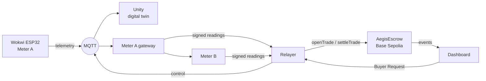

<div align="center">


# Aegis-Grid Africa

**Neighbour-to-neighbour solar power during load shedding, paid on-chain only when two meters agree.**


Tech Hub Africa Hackathon 2026

</div>

| | |
|---|---|
| 🎬 Demo video | _add before submission_ |
| 🌐 Live dashboard | _add before submission_ |
| 🔌 Wokwi simulation | _add before submission_ |
| 📜 Contract v2 (Base Sepolia) | [`0x2736…fc6e`](https://base-sepolia.blockscout.com/address/0x273651238fe3e2279d2295edcbd005f31347fc6e) |
| 🧾 On-chain evidence | [docs/evidence.md](docs/evidence.md) |

> [!NOTE]
> A working prototype on a public testnet. The meters are simulated (Wokwi ESP32 and a software meter); the escrow, the signatures and the payments are real testnet transactions. See [What is real](#what-is-real-and-what-is-simulated).

## The problem

- ☀️ **Wasted solar at noon.** Home solar often produces more than local batteries can absorb, and the surplus is curtailed.
- 🌙 **Load shedding at night.** Outages hit when shops need light and refrigeration most.
- 🛢️ **Diesel as the fallback.** Small businesses run generators that are costly and pollute the street.

## The solution

Households that already own a battery sell its stored solar energy to the shop next door during an outage. Each side has a smart meter that signs what it measured, and a smart contract releases the payment only when both readings agree.



1. **Day:** the battery charges from solar surplus.
2. **Outage:** the microgrid is islanded from the utility grid (the PCC opens). The shop presses **Request clean power** and pays a deposit into escrow.
3. **Supply:** the battery serves the shop first and keeps a 5% reserve. Community loads get power only if the owner allows emergency backup.
4. **Settlement:** both meters sign their final readings. Within 3% → the contract pays for what the shop received. Beyond 3% → the deposit is **frozen as Disputed**.

> [!IMPORTANT]
> Feeding power into utility lines during an outage endangers line workers. The design assumes a community microgrid with an islanding switch, so P2P supply happens only inside the islanded street.

## Proof on Base Sepolia

| What | Result |
|---|---|
| Honest trade (Wokwi Stage 4E model, contract v2) | 238 Wh sent, 233 Wh received (2.1%) → **settled** · [tx](https://base-sepolia.blockscout.com/tx/0xcf67f87b80471e80f406eb1b8d00d6773da470d4e20a2094ecee160d9efb8138) |
| Tampered buyer meter (contract v1) | 138 vs 81 Wh → **disputed, funds frozen** · [details](docs/evidence.md) |
| Seller payout | `withdraw()` paid out; a second attempt reverted · [details](docs/evidence.md) |
| Cost per settlement | ~98k to 184k gas measured on-chain; a dispute costs ~58k |
| Tests | 26 contract tests · 21 backend tests |

## What is real and what is simulated

| Part | Status |
|---|---|
| Seller meter (Meter A) | 🟡 Simulated: ESP32 in Wokwi, potentiometers instead of sensors |
| Buyer meter (Meter B) | 🟡 Simulated: separate process with its own key, 2% line loss |
| Digital twin | 🟢 Unity scene, driven live by the Wokwi telemetry |
| Signed readings, verification | 🟢 Real: EIP-712 signatures, checked again by the contract |
| Escrow, fee split, disputes, payouts | 🟢 Real contract on Base Sepolia (test ETH, no real money) |
| Mobile money, phone login | 🔴 Simulated in the UI only; roadmap |
| Offline LoRa mesh | 🔴 Design only; roadmap |

## Quick start

Requires Node.js 20+, [Foundry](https://getfoundry.sh) and Git. On Windows use WSL 2 ([setup guide](docs/dev-setup.md)).

```bash
git clone --recurse-submodules https://github.com/la-prmtsr/aegis-grid-africa.git
cd aegis-grid-africa && cp .env.example .env   # testnet keys only, never commit .env

cd contracts && forge test && cd ..           # 26 tests
cd bridge && npm install && npm test          # 21 tests
```

Run the demo without hardware (needs testnet keys and contract v2 in `.env`, see the [integration guide](docs/integration-v2.md)):

```bash
# terminal 1: Wokwi-compatible mock + Meter A + Meter B + relayer
cd bridge && npm run v2:mock        # add -- --monitor to run without any blockchain keys

# terminal 2: dashboard on http://localhost:5173/console.html?guest
cd web && npm install && npm run dev
```

In the dashboard: **Operator → Control room** (PV, load, utility outage, emergency backup, engine Mock or Wokwi live), turn on **Utility outage**, then **Buyer → Request power**, wait, then **Stop and pay**. Turn on **Tamper Meter B** first to see a dispute. Unity only visualises; every control is in the dashboard. Deployment, the Mosquitto bridge for Wokwi and all MQTT topics: [docs/integration-v2.md](docs/integration-v2.md).

## Repository

```
contracts/      AegisEscrow.sol + Foundry tests and deploy script
bridge/         backend: Meter A gateway, Meter B, relayer (src/v2), Wokwi adapter (src/aegis-unity)
web/            landing page, sign-in and live dashboard
docs/           integration guide, evidence, Mosquitto bridge config, setup
firmware/, tools/sim/   v1 meters, kept for the v1 evidence
```

| Layer | Stack |
|---|---|
| Contract | Solidity 0.8.28 · OpenZeppelin 5.4 · Foundry |
| Backend | Node.js 22 · ethers 6 · MQTT.js |
| Simulation | ESP32 on Wokwi · Unity · Mosquitto bridged to HiveMQ |
| Dashboard | Vite · JavaScript · three.js |

<details>
<summary><b>Smart contract functions</b></summary>

| Function | Caller | Purpose |
|---|---|---|
| `registerMeter(meter)` | household | Register the key that signs its meter readings |
| `openTrade(seller, pricePerWh, maxWh, duration)` | buyer | Escrow `maxWh × pricePerWh` |
| `settleTrade(id, sellerReading, sig, buyerReading, sig)` | relayer (anyone) | Check both signatures; settle or mark *Disputed* |
| `withdraw()` | anyone with a balance | Pull payment |
| `resolveDispute(id, acceptedWh)` | owner (arbiter) | Settle a disputed trade |
| `refundExpired(id)` | anyone | Refund an expired trade, or a dispute after 7 days |

Signatures are bound to the chain, the contract and the trade, so they cannot be replayed. Pausing never traps funds. **Tested, not audited.** The single-owner arbiter is a prototype simplification.

</details>

<details>
<summary><b>Design parameters</b> (choices, not measurements)</summary>

| Parameter | Value |
|---|---|
| Battery reserve | 5% (contract v2 and Wokwi; v1 used 20%) |
| Allocation during an outage | Buyer first; community load only with emergency-backup permission |
| Reading tolerance / simulated line loss | 3% / 2% |
| Fee split | 15% utility (grid fee) · 2% platform · rest to the seller |
| Demo price | 1 gwei per Wh (tiny, so the demo runs on faucet test ETH) |
| Energy accounting speed | 60× (1 s = 1 simulated minute), checked against the Wokwi battery model at run time |

</details>

<details>
<summary><b>Impact method</b></summary>

```
diesel avoided (L) = delivered energy (kWh) × generator fuel use (L/kWh)
CO2 avoided (kg)   = diesel avoided (L) × emission factor (kg CO2/L)
```

The dashboard uses 0.3 L/kWh and 2.68 kg CO2/L as **assumptions** until sources are cited. All energy figures in the demo come from simulated meters.

</details>

## Roadmap

- Certified meters with a hardware secure element instead of software keys
- Stablecoin settlement with mobile money payout and phone-number login
- Staking or a decentralised oracle instead of a single arbiter
- A pilot on one street, with the utility as a demand-response partner

## Team

| Name | Role |
|---|---|
| Alviola Permatasari | Smart contract, backend, verification |
| Faras | Wokwi meter firmware, Unity digital twin |
| _add name_ | Dashboard |

## License

[MIT](LICENSE)
