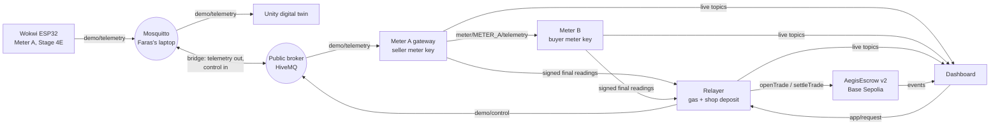

# Integration v2: Wokwi Stage 4E + Unity digital twin + dual-meter escrow

This replaces the v1 protocol (`docs/data-format.md`) for the live demo. Faras's Wokwi Stage 4E firmware and Unity scene are the source of truth and are **not changed**: the backend adapts to them.

Target flow: **Buyer Request in the app → backend → MQTT → Wokwi → telemetry (Unity follows it) → dual-meter verification → settlement on Base Sepolia.**

## Stage 5B.3: two ESP32 meters in Wokwi (default)

Faras's Stage 5B.2 firmware runs METER_A and METER_B as two ESP32 simulations. METER_A takes START/STOP commands in REMOTE mode, and both meters publish an **unsigned, simulated final event** when a trade ends. METER_B is derived from METER_A (`independentPhysicalMeasurement:false`), so these finals are telemetry evidence, not independent proof. The backend (`AEGIS_EVIDENCE=wokwi-final`, the default) works as follows:

1. Subscribes to `meter/+/final` and the telemetry **before** it sends any command.
2. Opens the escrow, then sends `demo/control/mode` (`WOKWI_MODE_REMOTE`, default `{"mode":"remote"}`) and `trade/cmd` `{"op":"start","tradeId":"<escrow id>","targetW":500}`. The tradeId is always the id from `TradeOpened`, never a typed `test-*` value. Only the app can start a trade; a buyer button pressed in Unity cannot create an escrow id.
3. On "Stop" in the app (or grid restored): `trade/cmd` `{"op":"stop","tradeId":"<id>"}`.
4. Stores every final event, command and status change in `bridge/data/evidence-<chainId>-<escrow>.jsonl` (server receipt time, topic, payload). Dedupe key: site, tradeId, meterId, role. Duplicates, replays (also after a restart), unknown or closed trades, wrong site/role/topic, `test-*` ids and invalid Wh are rejected and logged.
5. Checks the pair: buyer Wh > 0 and ≤ seller Wh, gap ≤ 3% on the **original fractional Wh**. In testnet mode also: seller ≥ `MIN_SETTLEMENT_WH` (5), then the same checks again on the **whole Wh (uint64, rounded down) that would be sent to the contract**, plus the trade maximum and the 5% battery reserve. Values are never adjusted. If any check fails, nothing is sent on-chain.

| `SETTLEMENT_MODE` | Result of a passing trade | On-chain |
|---|---|---|
| `off` (default) | `SIMULATION_VERIFIED` | nothing after `openTrade`; the deposit is refundable after expiry |
| `testnet` | each gateway signs its own meter's final (EIP-712, its own registered key), the relayer checks both against the verified whole Wh, then `settleTrade` | Base Sepolia test funds, labelled **`SIMULATED_TESTNET_SETTLEMENT`** in the backend, the receipt and the dashboard |

Trade statuses: `PENDING` → `ACTIVE` → `STOPPED` → `AWAITING_EVIDENCE` → `SIMULATION_VERIFIED` or `REJECTED`; in testnet mode `SIGNING` → `SETTLED` / `DISPUTED` / `FAILED`. They are published on `backend/status` and in a read-only API on the backend machine: `http://127.0.0.1:8790/health`, `/trades`, `/trades/<id>` (GET only).

**Trust model (what the contract checks).** `settleTrade` accepts a reading only if it is signed by the meter address the seller's account and the buyer's account each registered with `registerMeter`; one address cannot serve both accounts. The contract cannot tell whether that key sits in a meter or in a gateway, and it cannot prove that the two measurements are independent. In this prototype each key is held by a separate gateway process that attests the Wokwi final of its own meter. No contract change is needed and no signature check is bypassed; the simulation is stated in every label instead.

**Energy per trade.** The 5B.2 firmware counts in real time: at `targetW=500` the 5 Wh minimum takes about 36 s (Faras's `test-003` at about 100 W gave 2.47 Wh). Whole Wh are coarse for small trades: 33.9 vs 32.95 Wh passes on fractions (2.8%) but 33 vs 32 fails as uint64 (3.03%), and the backend then does not submit.

**Controls from the dashboard** (formats recorded from Unity on Faras's broker, 29 Oct): every control is a plain payload under `demo/control/`: `mode` → `remote`, `grid_outage` → `1`/`0`, `emergency_backup` → `1`/`0`, `buyer_request` → `1`/`0`, `pv_w` and `load_w` → watts. Set them in `.env` (`WOKWI_MODE_REMOTE=remote`, `WOKWI_CTRL_OUTAGE_TOPIC=grid_outage`, `WOKWI_CTRL_OUTAGE_ON=1`, `WOKWI_CTRL_OUTAGE_OFF=0`, same pattern for `BACKUP`, `BUYER`, and `WOKWI_CTRL_PV_TOPIC=pv_w` / `WOKWI_CTRL_PV_VALUE={value}`, `WOKWI_CTRL_LOAD_TOPIC=load_w` / `WOKWI_CTRL_LOAD_VALUE={value}`).

**Tamper** is a switch of the METER_B firmware: with `WOKWI_CTRL_TAMPER_TOPIC=meter_b_tamper` (`_ON=1`, `_OFF=0`) the dashboard tile publishes `demo/control/meter_b_tamper`, already covered by the bridge. METER_B then reports 60% of its value with `"tamper":true`. Without that setting the tile is disabled with the real firmware (it always works with the mock). A tampered trade fails the fractional check and is `REJECTED` before anything is sent on-chain.

## Who owns what

| Part | Owner | Code |
|---|---|---|
| Wokwi ESP32 Meter A (telemetry, dispatch, 5% reserve, outage, buyer first) | Faras | Wokwi Stage 4E project |
| Unity digital twin (energy animation, PCC, battery, buildings) | Faras | Unity project |
| MQTT broker (local Mosquitto + bridge to the public broker) | together | `docs/mosquitto-aegis-bridge.conf` |
| Stage 5A adapter (normalise, buyer-first allocation) | Faras's package, integrated | `bridge/src/aegis-unity/core.mjs` |
| Meter A gateway, Meter B, relayer, trade verification, escrow | Ola | `bridge/src/v2/`, `contracts/` |
| Dashboard | frontend | `web/` |

## Architecture



The three backend processes are separate programs, each holding only its own key (`npm run v2` starts them). The relayer never holds a meter key: it can only submit what the meters signed, and the contract checks the signatures again.

## Topics

All topics start with `aegis-grid/ag-sakarya26/`.

| Topic | Publisher → subscribers | Notes |
|---|---|---|
| `demo/telemetry` | Wokwi → Unity, Meter A gateway | Stage 4E JSON, unchanged |
| `demo/control/<name>` | relayer → Wokwi | `mode` (REMOTE) is used; outage/backup/PV/load formats still to be confirmed (see "Open items") |
| `trade/cmd` | relayer → METER_A firmware | Stage 5B: `{"op":"start","tradeId":"<escrow id>","targetW":W}`, `{"op":"stop","tradeId":"<id>"}` |
| `meter/METER_A/final`, `meter/METER_B/final` | firmware → relayer, gateways | Stage 5B: unsigned simulated finals, QoS 0, not retained |
| `meter/METER_A/telemetry` | gateway → Meter B, relayer, dashboard | normalised, 1 per Wokwi message, QoS 1 |
| `meter/METER_B/telemetry` | Meter B → dashboard; also METER_B firmware | the dashboard uses only `"v":2` messages (the backend's view) |
| `grid` | gateway → dashboard | retained, on change and every 10 s |
| `meter/METER_A/cmd`, `meter/METER_B/cmd` | relayer → gateways | `start` / `stop` (gateway evidence), `sign` (Stage 5B, testnet only) |
| `trade/<id>/reading/seller` and `/buyer` | meters → relayer, dashboard | signed final readings, retained |
| `backend/status` | relayer → dashboard | retained: active trade, approvals, last result, notices |
| `app/request` | dashboard → relayer | `{ "requesting": true \| false }` |
| `app/demo` | dashboard → relayer, Meter B, mock | `outage`, `backup`, `tamper`, `pvW`, `communityLoadW`, `engine` (mock only) |

## How the energy is counted (`AEGIS_EVIDENCE=gateway`, older Stage 4E firmware)

- **Meter A gateway** reads each Stage 4E message, checks it with Faras's rules and computes the buyer-first allocation with Faras's `allocate()`. During an outage the P2P flow to the shop is `buyerSuppliedW`; with the grid on, the shop is grid-fed and nothing is counted.
- Both meters integrate with the **same rule**: energy of interval (k−1, k] = power in message k−1 × simulated duration. An interval longer than 5 s counts as zero on both sides (no invented energy across a gap).
- **Meter B** applies the line loss (2%, `AEGIS_LINE_LOSS`) and has its own tamper switch (reports 60%). Its physical input in the simulation is the Wokwi power flow relayed by Meter A, which stands in for the cable. In production Meter B would have its own current sensor.
- **Order:** the relayer starts Meter B before Meter A, and stops Meter B at the exact sequence number of Meter A's last counted message, so both meters close on the same window.
- Each meter signs its own final reading (EIP-712, same struct as the contract) with the chain time minus 5 s. Whole Wh are rounded down; if the exact readings agree but the whole Wh do not, the trade is held instead of being frozen as a false dispute.

## Verification and settlement

The relayer checks, before spending gas: both-party approval (the buyer's request and deposit; the seller's meter registered on-chain plus `SELLER_CONSENT`), both signatures recover to the meters registered for this trade, readings are for the same trade, energy is above zero and within the trade maximum, the seller's battery is at or above the contract reserve, the telemetry during the trade broke none of Faras's rules (PCC isolation, demand consistency, reserve), and Meter B saw the end of the trade.

This section describes the gateway evidence path. `SETTLEMENT_MODE=off` applies here too: verified trades are not submitted.

- All checks pass and readings agree within 3%: `settleTrade` pays for what the buyer received.
- All checks pass but readings disagree: `settleTrade` is still sent, and the contract **freezes** the deposit as *Disputed*. This differs on purpose from "hold settlement": a trade that is never submitted expires and the buyer gets a full refund, which would reward a buyer who tampers with their meter.
- A check fails: the trade is **held** (not submitted) and the reason is published on `backend/status`. The deposit can be reclaimed with `refundExpired` after the trade expires (1 hour).

## Contract v2

`MIN_SOC_BPS` changes from 20% to **5%** to match the Stage 4E battery reserve. Nothing else changes. Tests: 26 passing (`cd contracts && forge test`). The v1 deployment `0x918a…4f6a` stays untouched as the evidence in `docs/evidence.md`; v2 is a new deployment.

## Time scale

Energy accounting uses `AEGIS_TIME_SCALE` (default 60: one real second counts as one simulated minute), so a one-minute demo trade is about 250 Wh at 250 W. Without it, a real-time minute at 250 W is only 4 Wh, and rounding to whole Wh turns honest trades into disputes.

The gateway measures how fast the Wokwi battery model runs, by comparing battery energy changes with the reported power, and logs it every minute:

```
[meter-A] Wokwi battery model runs at about 60x real time; energy accounting uses 60x
```

If it reports `MISMATCH` (for example the firmware runs in real time), the billed energy and the Wokwi battery state of charge do not change at the same rate. Either set `AEGIS_TIME_SCALE` to the measured value and run longer trades, or ask Faras whether the firmware can use the same scale. Say which one you chose in the video.

## Running it

One-time setup (Ola's laptop, WSL):

```bash
cd ~/aegis-grid-africa && git pull
cd bridge && npm install && npm test          # 31 tests: Faras's 6 + 16 for v2 + 9 for Stage 5B evidence
cd ../contracts && forge test                  # 26 tests
```

Deploy contract v2 and register the meters (Base Sepolia):

```bash
cd ~/aegis-grid-africa && set -a; source .env; set +a
cd contracts
forge script script/Deploy.s.sol --rpc-url $BASE_SEPOLIA_RPC_URL --private-key $DEPLOYER_PRIVATE_KEY --broadcast
# add the printed address to ../.env as ESCROW_V2_ADDRESS=0x...
cd ../bridge && npm run v2:setup
```

Run:

| Command (in `bridge/`) | When |
|---|---|
| `npm run v2` | Faras's Wokwi is running and bridged to the public broker |
| `npm run v2:mock` | Wokwi is off: a mock with the same Stage 4E fields and the Stage 5B.2 trade commands and finals (never run both) |
| `SETTLEMENT_MODE=testnet npm run v2` | recording the testnet demo (otherwise leave `off`) |
| `npm run v2:monitor` | Meters only, no blockchain: check that telemetry reaches the dashboard |
| `npm run adapter` | Faras's original read-only adapter (prints normalised telemetry) |

Dashboard: `web/.env` needs `VITE_SITE=ag-sakarya26`, `VITE_ESCROW_ADDRESS` = the v2 address and `VITE_DEPLOY_BLOCK` = its deploy block.

## What Faras needs to do

1. Replace the Aegis block at the end of his `mosquitto.conf` with the current `docs/mosquitto-aegis-bridge.conf` (it now also forwards `meter/+/final` out and `trade/cmd` in) and restart Mosquitto. Wokwi and Unity are not touched.
2. Confirm the exact REMOTE-mode payload on `demo/control/mode` (the backend sends `{"mode":"remote"}`; change `WOKWI_MODE_REMOTE` if it differs), and send the outage/backup/PV/load control formats (open item 1).
3. Add the Stage 4E firmware (`sketch.ino`, `diagram.json`, `wokwi.toml`) to the repository, for example under `firmware/wokwi-stage4e/`, and share the Wokwi project link for the README. Judges need both.

## Open items

1. **Wokwi control format.** Stage 5B: the buyer request is now `trade/cmd` START/STOP (known format); the REMOTE-mode payload needs Faras's confirmation. The exact sub-topics and JSON under `demo/control/` for buyer request, outage and emergency backup are not known yet. Until they are set in `.env` (`WOKWI_CTRL_BUYER_TOPIC`, `WOKWI_CTRL_BUYER_ON`, `WOKWI_CTRL_BUYER_OFF`, same for `OUTAGE` and `BACKUP`), the relayer only logs what it would send, and the buyer request must be pressed in Wokwi or Unity (the backend then opens the trade by itself). The PV and local-load sliders of the dashboard Control room use `WOKWI_CTRL_PV_TOPIC` / `WOKWI_CTRL_PV_VALUE` and `WOKWI_CTRL_LOAD_TOPIC` / `WOKWI_CTRL_LOAD_VALUE`, where `{value}` in the payload is replaced by the watts (for example `{"pv_power_w":{value}}`). While a control is not configured, its slider is disabled when Wokwi live is the source. The mock uses a provisional format only for development.
2. **Time scale** of the Stage 4E firmware (see above).
3. Seller consent is a standing permission (meter registered on-chain plus `SELLER_CONSENT=true`), not a per-trade click.

## Tested (29 October 2026, Stage 5B.3, local chain and two local Mosquitto brokers)

A local broker in Faras's role (mock firmware, bridged with the current `mosquitto-aegis-bridge.conf`) and a local "public" broker for the backend and dashboard. `off`: 5.566 vs 5.455 Wh (2.00%) → `SIMULATION_VERIFIED`, no settlement. `testnet`: 5.562 vs 5.451 Wh → whole 5 vs 5 → both gateways signed → `SETTLED` on-chain, labelled `SIMULATED_TESTNET_SETTLEMENT`. Tampered METER_B (41.2% gap) → `REJECTED`, nothing sent. 2.09 Wh trade → `REJECTED` (below 5 Wh). A replayed final and a `test-003` final → rejected. Records survived a backend restart. In a headless browser: buyer request, receipt "Simulation verified" (off) and "Settled · paid" with the testnet label, Oracle statuses. Not yet run against Faras's real Wokwi and Base Sepolia.

## Tested (28 October 2026, local chain and local Mosquitto)

With the mock, the three backend processes and contract v2 on anvil: an honest trade requested from the app settled (83 vs 82 Wh); a trade with the buyer meter tampered was frozen as Disputed (63 vs 37 Wh); a trade started from the Wokwi button without the app settled (58 vs 57 Wh). In a headless browser the dashboard showed live telemetry, opened a trade from "Request power", showed the live session (245 W) and the verified receipt after "Stop and pay" (88 vs 86 Wh). Not yet run against Faras's real Wokwi, the public broker and Base Sepolia.

## Security notes

The public broker has no authentication: anyone could publish on these topics. Readings cannot be forged (the relayer and the contract check the meter signatures), but someone could send `app/request` and open a demo trade with test ETH. Production needs per-device credentials and TLS.

## Stage 6: order size ("takaran") and auto-stop

The buyer chooses how much energy to receive before paying. The rules live in `bridge/src/v2/sizing.js` and
`web/src/lib/sizing.js` (identical, checked by `bridge/test/sizing.test.mjs`) and depend on how fast METER_A's
trade counter `p2p_trade_wh` runs, set with `FIRMWARE_ENERGY_SCALE` in `.env`:

| `FIRMWARE_ENERGY_SCALE` | Counter | Orders | 500 W delivers | Stop rule |
|---|---|---|---|---|
| `1` (default, Faras's 5B.2 firmware) | real time, about 0.14 Wh per report | 10, 20, 50, 100 … Wh (steps of 10) | 10 Wh in about 72 s | just past the order (+0.02 Wh) |
| `60` (if the firmware counts at 60×) | about 8.3 Wh per report | 100, 250, 500 Wh (steps of 50) | 100 Wh in about 12 s | half a report early |

- The app sends `app/request {"requesting":true,"targetWh":20}`. The relayer opens the escrow for
  `maxWh = order + ceil(order × line loss) + ceil(2 reports) + 2` (20 Wh → 24 Wh in real time) and publishes the
  rate as `params.orderRate` in `backend/status`, so the dashboard shows the same steps and deposit.
- The relayer follows `p2p_trade_wh`, estimates what METER_B received (× 0.98) and sends `trade/cmd stop` at the
  stop point above. In real time the finals then land just above a whole Wh, so the contract's whole-Wh 3% check
  always passes (live test trade 8, stopped at a random point: 23.19 vs 22.73 Wh became 23 vs 22 Wh = 4.3%, rejected).
  At 60× the 100 Wh minimum does the same job: from about 67 Wh up honest readings always pass.
- A buyer who presses Stop early stops at a random point; a small trade can then still be rejected and the deposit
  is refunded after expiry.
- The buyer pays only for what METER_B received. Prices in the dashboard are in Ghana cedi (`VITE_PRICE_PER_KWH`,
  default GH₵3.50/kWh, a demo assumption between the grid tariff and a diesel generator).
