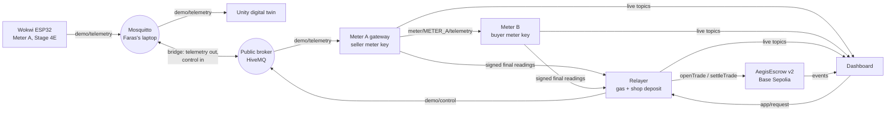

# Integration v2: Wokwi Stage 4E + Unity digital twin + dual-meter escrow

This replaces the v1 protocol (`docs/data-format.md`) for the live demo. Faras's Wokwi Stage 4E firmware and Unity scene are the source of truth and are **not changed**: the backend adapts to them.

Target flow: **Buyer Request in the app → backend → MQTT → Wokwi → telemetry (Unity follows it) → dual-meter verification → settlement on Base Sepolia.**

## Who owns what

| Part | Owner | Code |
|---|---|---|
| Wokwi ESP32 Meter A (telemetry, dispatch, 5% reserve, outage, buyer first) | Faras | Wokwi Stage 4E project |
| Unity digital twin (energy animation, PCC, battery, buildings) | Faras | Unity project |
| MQTT broker (local Mosquitto + bridge to the public broker) | together | `docs/mosquitto-aegis-bridge.conf` |
| Stage 5A adapter (normalise, buyer-first allocation) | Faras's package, integrated | `bridge/src/aegis-unity/core.mjs` |
| Meter A gateway, Meter B, relayer, trade verification, escrow | Ola | `bridge/src/v2/`, `contracts/` |
| Dashboard | frontend | `web/` |

## Architecture



The three backend processes are separate programs, each holding only its own key (`npm run v2` starts them). The relayer never holds a meter key: it can only submit what the meters signed, and the contract checks the signatures again.

## Topics

All topics start with `aegis-grid/ag-sakarya26/`.

| Topic | Publisher → subscribers | Notes |
|---|---|---|
| `demo/telemetry` | Wokwi → Unity, Meter A gateway | Stage 4E JSON, unchanged |
| `demo/control/<name>` | relayer → Wokwi | format to be confirmed by Faras (see "Open items") |
| `meter/METER_A/telemetry` | gateway → Meter B, relayer, dashboard | normalised, 1 per Wokwi message, QoS 1 |
| `meter/METER_B/telemetry` | Meter B → dashboard | |
| `grid` | gateway → dashboard | retained, on change and every 10 s |
| `meter/METER_A/cmd`, `meter/METER_B/cmd` | relayer → meters | `start` (tradeId, maxWh), `stop` (tradeId, untilSeq) |
| `trade/<id>/reading/seller` and `/buyer` | meters → relayer, dashboard | signed final readings, retained |
| `backend/status` | relayer → dashboard | retained: active trade, approvals, last result, notices |
| `app/request` | dashboard → relayer | `{ "requesting": true \| false }` |
| `app/demo` | dashboard → relayer, Meter B, mock | `outage`, `backup`, `tamper`, `pvW`, `communityLoadW`, `engine` (mock only) |

## How the energy is counted

- **Meter A gateway** reads each Stage 4E message, checks it with Faras's rules and computes the buyer-first allocation with Faras's `allocate()`. During an outage the P2P flow to the shop is `buyerSuppliedW`; with the grid on, the shop is grid-fed and nothing is counted.
- Both meters integrate with the **same rule**: energy of interval (k−1, k] = power in message k−1 × simulated duration. An interval longer than 5 s counts as zero on both sides (no invented energy across a gap).
- **Meter B** applies the line loss (2%, `AEGIS_LINE_LOSS`) and has its own tamper switch (reports 60%). Its physical input in the simulation is the Wokwi power flow relayed by Meter A, which stands in for the cable. In production Meter B would have its own current sensor.
- **Order:** the relayer starts Meter B before Meter A, and stops Meter B at the exact sequence number of Meter A's last counted message, so both meters close on the same window.
- Each meter signs its own final reading (EIP-712, same struct as the contract) with the chain time minus 5 s.

## Verification and settlement

The relayer checks, before spending gas: both-party approval (the buyer's request and deposit; the seller's meter registered on-chain plus `SELLER_CONSENT`), both signatures recover to the meters registered for this trade, readings are for the same trade, energy is above zero and within the trade maximum, the seller's battery is at or above the contract reserve, the telemetry during the trade broke none of Faras's rules (PCC isolation, demand consistency, reserve), and Meter B saw the end of the trade.

- All checks pass and readings agree within 3%: `settleTrade` pays for what the buyer received.
- All checks pass but readings disagree: `settleTrade` is still sent, and the contract **freezes** the deposit as *Disputed*. This differs on purpose from "hold settlement": a trade that is never submitted expires and the buyer gets a full refund, which would reward a buyer who tampers with their meter.
- A check fails: the trade is **held** (not submitted) and the reason is published on `backend/status`. The deposit can be reclaimed with `refundExpired` after the trade expires (1 hour).

## Contract v2

`MIN_SOC_BPS` changes from 20% to **5%** to match the Stage 4E battery reserve. Nothing else changes. Tests: 26 passing (`cd contracts && forge test`). The v1 deployment `0x918a…4f6a` stays untouched as the evidence in `docs/evidence.md`; v2 is a new deployment.

## Time scale

Energy accounting uses `AEGIS_TIME_SCALE` (default 60: one real second counts as one simulated minute), so a one-minute demo trade is about 250 Wh at 250 W. Without it, a real-time minute at 250 W is only 4 Wh, and rounding to whole Wh turns honest trades into disputes.

The gateway measures how fast the Wokwi battery model runs, by comparing battery energy changes with the reported power, and logs it every minute:

```
[meter-A] Wokwi battery model runs at about 60x real time; energy accounting uses 60x
```

If it reports `MISMATCH` (for example the firmware runs in real time), the billed energy and the Wokwi battery state of charge do not change at the same rate. Either set `AEGIS_TIME_SCALE` to the measured value and run longer trades, or ask Faras whether the firmware can use the same scale. Say which one you chose in the video.

## Running it

One-time setup (Ola's laptop, WSL):

```bash
cd ~/aegis-grid-africa && git pull
cd bridge && npm install && npm test          # 21 tests: Faras's 6 + 15 for v2
cd ../contracts && forge test                  # 26 tests
```

Deploy contract v2 and register the meters (Base Sepolia):

```bash
cd ~/aegis-grid-africa && set -a; source .env; set +a
cd contracts
forge script script/Deploy.s.sol --rpc-url $BASE_SEPOLIA_RPC_URL --private-key $DEPLOYER_PRIVATE_KEY --broadcast
# add the printed address to ../.env as ESCROW_V2_ADDRESS=0x...
cd ../bridge && npm run v2:setup
```

Run:

| Command (in `bridge/`) | When |
|---|---|
| `npm run v2` | Faras's Wokwi is running and bridged to the public broker |
| `npm run v2:mock` | Wokwi is off: a mock with the same Stage 4E fields (never run both) |
| `npm run v2:monitor` | Meters only, no blockchain: check that telemetry reaches the dashboard |
| `npm run adapter` | Faras's original read-only adapter (prints normalised telemetry) |

Dashboard: `web/.env` needs `VITE_SITE=ag-sakarya26`, `VITE_ESCROW_ADDRESS` = the v2 address and `VITE_DEPLOY_BLOCK` = its deploy block.

## What Faras needs to do

1. Add `docs/mosquitto-aegis-bridge.conf` to the end of his `mosquitto.conf` and restart Mosquitto. Wokwi and Unity are not touched. Tested with Mosquitto 2.0.18: telemetry goes out once (no loops), control comes in, Unity's local controls stay local.
2. Send the control format (open item 1).
3. Add the Stage 4E firmware (`sketch.ino`, `diagram.json`, `wokwi.toml`) to the repository, for example under `firmware/wokwi-stage4e/`, and share the Wokwi project link for the README. Judges need both.

## Open items

1. **Wokwi control format.** The exact sub-topics and JSON under `demo/control/` for buyer request, outage and emergency backup are not known yet. Until they are set in `.env` (`WOKWI_CTRL_BUYER_TOPIC`, `WOKWI_CTRL_BUYER_ON`, `WOKWI_CTRL_BUYER_OFF`, same for `OUTAGE` and `BACKUP`), the relayer only logs what it would send, and the buyer request must be pressed in Wokwi or Unity (the backend then opens the trade by itself). The PV and local-load sliders of the dashboard Control room use `WOKWI_CTRL_PV_TOPIC` / `WOKWI_CTRL_PV_VALUE` and `WOKWI_CTRL_LOAD_TOPIC` / `WOKWI_CTRL_LOAD_VALUE`, where `{value}` in the payload is replaced by the watts (for example `{"pv_power_w":{value}}`). While a control is not configured, its slider is disabled when Wokwi live is the source. The mock uses a provisional format only for development.
2. **Time scale** of the Stage 4E firmware (see above).
3. Seller consent is a standing permission (meter registered on-chain plus `SELLER_CONSENT=true`), not a per-trade click.

## Tested (28 October 2026, local chain and local Mosquitto)

With the mock, the three backend processes and contract v2 on anvil: an honest trade requested from the app settled (83 vs 82 Wh); a trade with the buyer meter tampered was frozen as Disputed (63 vs 37 Wh); a trade started from the Wokwi button without the app settled (58 vs 57 Wh). In a headless browser the dashboard showed live telemetry, opened a trade from "Request power", showed the live session (245 W) and the verified receipt after "Stop and pay" (88 vs 86 Wh). Not yet run against Faras's real Wokwi, the public broker and Base Sepolia.

## Security notes

The public broker has no authentication: anyone could publish on these topics. Readings cannot be forged (the relayer and the contract check the meter signatures), but someone could send `app/request` and open a demo trade with test ETH. Production needs per-device credentials and TLS.
